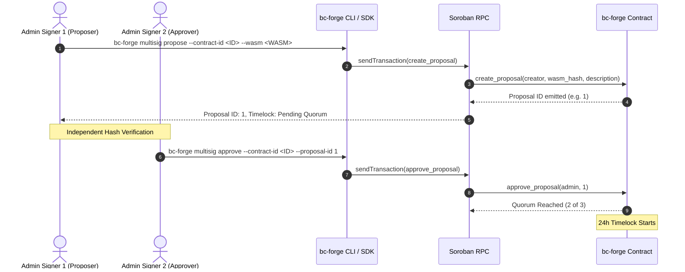

# Step-by-Step Contract Upgrade and Storage Migration Playbook

This playbook provides an operational runbook and emergency checklist for executing zero-downtime Soroban contract upgrades under multisig governance on the `bc-forge` token platform.

---

## 1. Overview & Operational Principles

### Zero-Downtime Architecture
Soroban smart contracts in `bc-forge` separate contract executable code (WASM byte code referenced by a 32-byte hash) from contract storage (`instance` and `persistent` ledger entries). Upgrading a contract executes in-place:
- Existing state, account balances, allowance mappings, and access control entries remain intact.
- In-flight client transactions either execute against the current WASM or the upgraded WASM based on ledger transaction ordering, ensuring zero downtime.

### Governance Requirements
Production contract upgrades require multisig governance:
- **Admin Pool:** Quorum threshold of $M$-of-$N$ admin keyholders (configured via `set_admin_pool`).
- **Timelock:** A mandatory 24-hour timelock between reaching approval quorum and upgrade execution.
- **Auditability:** Every proposal, approval, and execution event is emitted on-chain and indexed.

---

## 2. Pre-Upgrade Preparation & Checklist

Before initiating an upgrade ceremony, complete the following pre-flight verification steps:

- [ ] **WASM Artifact Build:**
  Compile the deterministic release binary:
  ```bash
  cargo build --target wasm32-unknown-unknown --release -p bc-forge-token
  ```
  Artifact location: `target/wasm32-unknown-unknown/release/bc_forge_token.wasm`.

- [ ] **WASM Hash Verification:**
  Calculate SHA-256 hash of the compiled artifact:
  ```bash
  # Linux / macOS
  sha256sum target/wasm32-unknown-unknown/release/bc_forge_token.wasm
  # Windows PowerShell
  Get-FileHash target\wasm32-unknown-unknown\release\bc_forge_token.wasm -Algorithm SHA256
  ```
  Signers must independently verify and agree upon this 32-byte hex hash.

- [ ] **Storage Compatibility Audit:**
  Review storage layout changes:
  - Function names and parameter types must match or be strictly additive.
  - Instance keys (`Admin`, `SuperAdmin`, `Decimals`, `Name`, `Symbol`) must maintain consistent data types.
  - Allowance storage must adhere to unified `AllowanceData` struct format (`amount: i128`, `expiration_ledger: u32`).
  - Numeric error discriminants (`TokenError`, `AdminError`) must not be renumbered or removed.

---

## 3. Step 1: Pre-Flight Dry Run Simulation

Perform a local simulation to estimate resource consumption (CPU instructions, memory, read/write footprints) and ensure the upgrade transaction will not revert on-chain.

### Running CLI Dry Run

Use the `bc-forge` CLI `--dry-run` and `--estimate` options:

```bash
# Dry run simulation without broadcasting
bc-forge upgrade \
  --contract-id <CONTRACT_ID> \
  --wasm target/wasm32-unknown-unknown/release/bc_forge_token.wasm \
  --network <testnet|mainnet> \
  --dry-run

# Fee and footprint estimation
bc-forge upgrade \
  --contract-id <CONTRACT_ID> \
  --wasm target/wasm32-unknown-unknown/release/bc_forge_token.wasm \
  --network <testnet|mainnet> \
  --estimate
```

### Dry Run Verification Criteria

- [ ] **Simulation Status:** `SUCCESS` (no contract panic or simulation error).
- [ ] **Resource Limits:**
  - CPU instructions within ledger limits (< 100,000,000 instructions).
  - RAM within transaction budget.
- [ ] **Footprint Check:**
  - Read-write footprint contains the contract executable entry and instance storage.
- [ ] **Fee Estimate:**
  - Base fee and resource fee documented for proposal funding.

---

## 4. Step 2: Multisig Approval Ceremony



### 2.1 Submit Proposal
Any active member of the admin pool submits the upgrade proposal:

```bash
# Using CLI
bc-forge multisig propose \
  --contract-id <CONTRACT_ID> \
  --wasm target/wasm32-unknown-unknown/release/bc_forge_token.wasm \
  --description "Upgrade to v2.1.0: Optimize balance query and allowance storage" \
  --network <testnet|mainnet>
```

Alternatively, invoke via Soroban CLI:
```bash
stellar contract invoke \
  --id <CONTRACT_ID> \
  --source $ADMIN_1_SECRET \
  --network <testnet|mainnet> \
  -- \
  create_proposal \
  --creator <ADMIN_1_PUBLIC_KEY> \
  --description "Upgrade to v2.1.0"
```
Record the resulting `proposal_id` (e.g., `1`).

### 2.2 Collect Signatures & Approvals
Remaining required signers review the proposed WASM hash against their independently built binary and submit their approvals:

```bash
# Signer 2 Approval
bc-forge multisig approve \
  --contract-id <CONTRACT_ID> \
  --proposal-id 1 \
  --network <testnet|mainnet>
```

Or via SDK:
```typescript
import { bcForgeClient } from '@bc-forge/sdk';
import { Keypair } from '@stellar/stellar-sdk';

const client = new bcForgeClient({
  rpcUrl: process.env.SOROBAN_RPC_URL!,
  networkPassphrase: process.env.STELLAR_NETWORK_PASSPHRASE!,
  contractId: process.env.CONTRACT_ID!,
});

const signerKeypair = Keypair.fromSecret(process.env.ADMIN_2_SECRET!);
await client.approveProposal(signerKeypair.publicKey(), 1n, signerKeypair);
```

---

## 5. Step 3: Timelock Monitoring & Verification

Once quorum is achieved, the 24-hour security timelock begins. During this window, the contract cannot be upgraded.

### Check Unlock Time
Query the exact unlock timestamp:

```bash
stellar contract invoke \
  --id <CONTRACT_ID> \
  --network <testnet|mainnet> \
  -- \
  get_proposal_unlock_time \
  --proposal_id 1
```

```typescript
// Via SDK or status monitor script
const unlockTime = await client.getProposalUnlockTime(1n);
const currentTime = Math.floor(Date.now() / 1000);
const remainingSeconds = Number(unlockTime) - currentTime;

console.log(`Timelock expires at: ${new Date(Number(unlockTime) * 1000).toISOString()}`);
console.log(`Remaining time: ${Math.max(0, remainingSeconds)}s`);
```

### Emergency Cancellation
If a security vulnerability or discrepancy is discovered during the 24-hour timelock window:
- The proposal creator (or admin pool) can cancel the proposal before execution:
```bash
stellar contract invoke \
  --id <CONTRACT_ID> \
  --source $ADMIN_1_SECRET \
  --network <testnet|mainnet> \
  -- \
  cancel_proposal \
  --proposal_id 1
```

---

## 6. Step 4: Execution & Contract Migration

Once `current_timestamp >= unlock_time`, execute the upgrade.

### 4.1 Install New WASM (if not installed)
Upload the new WASM bytecode to the Stellar network:
```bash
WASM_HASH=$(stellar contract install \
  --wasm target/wasm32-unknown-unknown/release/bc_forge_token.wasm \
  --source $ADMIN_SECRET \
  --network <testnet|mainnet>)
echo "Installed WASM Hash: $WASM_HASH"
```

### 4.2 Execute Upgrade
Submit the execution transaction:

```bash
# Using CLI
bc-forge multisig execute \
  --contract-id <CONTRACT_ID> \
  --proposal-id 1 \
  --wasm-hash $WASM_HASH \
  --network <testnet|mainnet>
```

Or via SDK:
```typescript
const result = await client.executeProposal(1n, adminKeypair);
console.log(`Upgrade confirmed. Transaction: ${result.hash}`);
```

---

## 7. Step 5: Post-Upgrade Verification & Storage Migration

Execute the post-upgrade verification checklist immediately following confirmation.

### 7.1 Verify Contract Version & Identity
```bash
stellar contract invoke \
  --id <CONTRACT_ID> \
  --network <testnet|mainnet> \
  -- \
  version
```
- [ ] Returned version string matches expected release (e.g. `"2.1.0"`).

### 7.2 Access Control Verification
Verify admin and role memberships remain intact:
```bash
stellar contract invoke \
  --id <CONTRACT_ID> \
  --network <testnet|mainnet> \
  -- \
  has_role \
  --role Admin \
  --address <ADMIN_PUBLIC_KEY>
```
- [ ] Confirms `true` for active administrators.
- [ ] Check `SuperAdmin` presence using SDK or CLI query.

### 7.3 Storage Migration Audit
For legacy contract migrations (e.g., RBAC migration or allowance normalization):
1. **RBAC Migration Check (`migrate_admin`):**
   If migrating a pre-RBAC contract, invoke `migrate_admin`:
   ```bash
   stellar contract invoke \
     --id <CONTRACT_ID> \
     --source $ADMIN_SECRET \
     --network <testnet|mainnet> \
     -- \
     migrate_admin
   ```
   Ensure subsequent calls return early without error (idempotent).
2. **Allowance Migration Check:**
   Perform a read and sample allowance operation to confirm lazy conversion from dual-key storage to unified `AllowanceData`.

### 7.4 Critical Path Smoke Tests
Perform automated or manual smoke tests on core token operations:
- [ ] **Balance Query:**
  ```typescript
  const balance = await client.getBalance('<TEST_ACCOUNT>');
  console.log(`Balance verified: ${balance}`);
  ```
- [ ] **Test Mint / Transfer:**
  Execute a 1 stroop test transfer to verify execution pipeline:
  ```typescript
  const testTx = await client.transfer(testSender, testReceiver, 1n, senderKeypair);
  console.log(`Test transfer successful: ${testTx.hash}`);
  ```

---

## 8. Emergency Rollback Procedure

If severe regressions are detected post-upgrade:

1. **Leverage Upgrade History:**
   The `bc-forge` CLI automatically tracks the previous WASM hash in `~/.bc-forge/upgrade-history.json`.
2. **Fast-Track Rollback Proposal:**
   ```bash
   bc-forge upgrade \
     --contract-id <CONTRACT_ID> \
     --to-last-good \
     --network <testnet|mainnet>
   ```
3. **Emergency Multisig Quorum:**
   Convene admin pool members to approve and execute the rollback proposal following the same ceremony.
